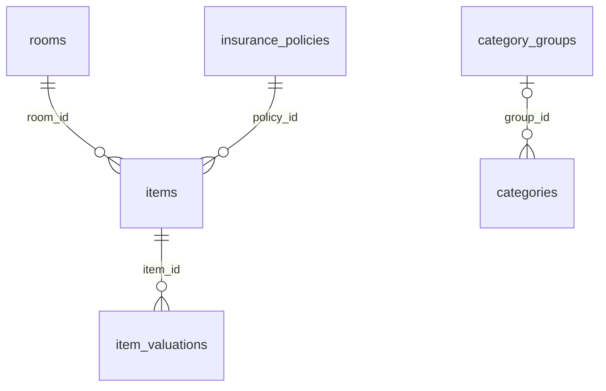

# Home inventory (QHI) SQLite schema

What the Quicken Home Inventory export contains. It is built from a
`QHI.IDB` file by `export_qhi_to_sqlite` in `src/qdf_tools/qhi_idb.py`
(`scripts/export_qhi_sqlite.py`). That file's `SCHEMA` is the source of truth;
update this page when it changes. This is a separate database from the
financial export ([sqlite-schema.md](sqlite-schema.md)).

Current `schema_version`: **9**. Checked against a real export on 2026-10-26.

## Conventions

- Each run deletes the destination file and writes it again from scratch.
- **Money is `TEXT`** holding the float Quicken stored, written with up to 17
  significant digits (for example `529500`, `317`). There are no `*_numeric`
  columns; use `CAST(x AS REAL)`.
- **Dates are `TEXT`**, ISO `YYYY-MM-DD`, or `NULL` when not set or invalid.
- **IDs are QHI record IDs**, kept from the source file, not renumbered.

## Relationships



Items have no category column. The export reads the category list, but it
does not decode which category an item belongs to.

## Tables

### `metadata`

Key/value facts. Keys: `schema_version`, `source_format` (`qhi-idb`),
`source_name`, `source_size`, `source_sha256` (hash of the source IDB), and
counts: `record_count`, `room_count`, `category_count`, `item_count`,
`item_valuation_count`.

### `items`

One row per inventory item.

| Column | Meaning |
|---|---|
| `id` | QHI record ID. |
| `room_id` | → `rooms.id`. Always set. |
| `policy_id` | → `insurance_policies.id`. Always set; items not on a policy point at `Unassigned`. |
| `description` | Item description. |
| `purchase_location` | Where it was bought. |
| `make_model`, `serial_number` | Make/model and serial number. |
| `notes` | Free-text notes. |
| `replacement_cost` | Replacement cost. |
| `original_price` | Purchase price. |
| `resale_value` | Latest resale value: the newest row in `item_valuations` (by date, then `record_id`); `NULL` if there is none. |
| `purchase_date` | Purchase date, often `NULL`. |

### `item_valuations`

Resale value history. Primary key `(item_id, record_id)`.
`item_id` → `items.id`, `record_id` (QHI record ID of the valuation),
`valuation_date`, `resale_value`.

### `rooms`

`id`, `name`, `is_defined`. When an item references a room ID that has no
room record, the export adds a placeholder row with `is_defined = 0` and the
name `[unresolved QHI room <id>]`.

### `insurance_policies`

`id`, `name`, `insurer`, `coverage` (coverage amount, text). Includes an
`Unassigned` pseudo-policy with no insurer or coverage.

### `category_groups`, `categories`

Quicken Home Inventory's category list: groups (`id`, `name`) and categories
(`id`, `group_id`, `name`). `group_id` is a raw value from the record. It
usually matches `category_groups.id`, but not always, so use a `LEFT JOIN`.

## Indexes

`items(room_id)`, `items(policy_id)`, `item_valuations(item_id, valuation_date)`.

## Example query

Replacement cost and resale value by room:

```sql
SELECT r.name AS room,
       COUNT(*) AS items,
       SUM(CAST(i.replacement_cost AS REAL)) AS replacement_cost,
       SUM(CAST(i.resale_value AS REAL)) AS resale_value
FROM items i
JOIN rooms r ON r.id = i.room_id
GROUP BY r.name
ORDER BY replacement_cost DESC;
```
