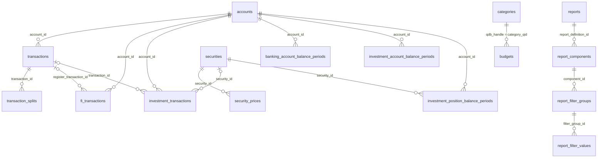

# SQLite schema

What the export database contains. The source of truth is `SCHEMA` in
`src/qdf_tools/sqlite_export.py` and `REPORT_SCHEMA` in
`src/qdf_tools/qdb_reports.py`; update this page when those change.
The home inventory export is a separate database; see
[qhi-sqlite-schema.md](qhi-sqlite-schema.md).

Current `schema_version`: **38**. The base export writes 32; adding the saved-report tables raises it to 38.
Checked against a real extract on 2026-10-26.

## Conventions

- **Money, prices, shares are `TEXT`** holding exact decimal strings (for
  example `-42.10`). Most such columns have a `*_numeric` `REAL` generated
  column (`CAST(x AS REAL)`) for arithmetic and sorting. Sum the text column
  through `CAST`/`*_numeric` for quick work; parse the text for exact cents.
  Exception: `banking_account_balance_periods.balance_cents` is an integer.
- **Dates are `TEXT`**, ISO `YYYY-MM-DD`.
- **Booleans are `INTEGER`** 0/1 (`is_*` columns).
- **`qdb_*` columns** are raw Quicken database (QDB) identifiers: handles,
  internal IDs, register refs. Use them to trace a row back to the source or
  to join tables that share a QDB key (for example `budgets.category_qid` →
  `categories.qdb_handle`).
- **Balance periods** hold one row per date where a balance changes. A
  row is valid from `balance_date` (inclusive) to `next_balance_date`
  (exclusive); `next_balance_date` is `NULL` on the latest row. To get the
  balance on day `D`:
  `balance_date <= D AND (next_balance_date IS NULL OR next_balance_date > D)`.

## Relationships



`transactions.category`, `tag` and `transfer_account` are names stored as
text, not foreign keys.

## Tables

### `metadata`

Key/value facts about the export (`key` primary key, `value` text).
Common keys: `schema_version`, `source_format`, `extract_date`,
`transaction_count`, `security_count`, `security_price_count`,
`budget_count`, `budget_year_count`, `saved_report_count`, and
`account_*_source` keys naming where account attributes were read from.

### `accounts`

One row per Quicken account, including closed and hidden ones.

| Column | Meaning |
|---|---|
| `id` | Primary key. |
| `name` | Account name (unique). |
| `account_type` | `Investing`, `Banking`, `Credit Card`, `Loan`, `Asset`, `Vehicle`, `House`, `Cash`. |
| `qdb_handle` | Account handle in the QDB. |
| `is_closed` | Account is closed. |
| `is_separate` | Marked "separate" (excluded from reports/budgets). |
| `is_hidden`, `is_hidden_in_bar`, `is_hidden_in_list` | Quicken visibility flags. Hidden usually means retired, not junk. |

### `categories`, `tags`

Name lists. `id`, unique `name`, `qdb_handle`. Category names use Quicken's
`Parent:Child` form.

### `transactions`

The register: one row per transaction in banking, credit, and asset
accounts (plus cash-side investment register entries).

| Column | Meaning |
|---|---|
| `id` | Primary key. |
| `account_id` | → `accounts.id`. |
| `transaction_date` | Posting date. |
| `amount` / `amount_numeric` | Signed amount; negative is money out. |
| `payee` | Payee as shown in the register. |
| `downloaded_payee` | Payee as the bank sent it, when different. |
| `payee_source` | Which source field `payee` came from (often `NULL`). |
| `memo`, `number` | Memo and check number. |
| `fit_id` | Bank's download ID (FITID), when downloaded. |
| `security`, `price`, `quantity`, `commission` | Investment details when the row is an investment action. |
| `category`, `tag` | Category/tag name. A split parent has category `--Split--` and its lines in `transaction_splits` sum to its amount. |
| `transfer_account` | Other account's name if this is a transfer. |
| `cleared` | `R` reconciled, `c` cleared, `NULL` uncleared. |
| `qdb_record_type` | QDB record type the row was decoded from, e.g. `QDB:0xf7` (register). |
| `qdb_internal_id`, `qdb_register_ref` | Source identifiers. |

Indexed on date, (account, date), and payee.

### `transaction_splits`

Split lines of a transaction. `transaction_id` → `transactions.id`,
`line_number` (unique per transaction), `category`, `transfer_account`,
`memo`, `amount` / `amount_numeric`. Use split amounts, not the parent,
when grouping by category.

### `fi_transactions`

Downloaded bank (financial institution) records, matched to the register
where possible.

| Column | Meaning |
|---|---|
| `register_transaction_id` | → `transactions.id` that this download was matched to, or `NULL`. |
| `account_id` | → `accounts.id`. |
| `transaction_date`, `amount`, `payee`, `fit_id`, `cleared` | As downloaded. |
| `qdb_record_type`, `qdb_internal_id` (unique), `qdb_register_ref` | Source identifiers (`qdb_record_type` is `QDB:0x13c`). |
| `link_method` | How the match was made: `FITID/0x086`, `0x096` (register link), or `NULL` (unmatched). |

### `securities`

`id`, `qdb_security_ref` (unique), `name`, `symbol`.

### `security_prices`

Price history. `security_id` → `securities.id`, `price_date`, `price`,
`high`, `low`, `volume`, plus `*_numeric`. One row per security per date.

### `investment_transactions`

Investment register actions.

| Column | Meaning |
|---|---|
| `account_id` | → `accounts.id`. |
| `transaction_id` | → `transactions.id` for the matching register row, if any. |
| `register_key` | Position in the account's register (unique per account). |
| `transaction_date`, `transaction_type` | Date and Quicken action (`Bought`, `Sold`, `ReinvDiv`, `Div`, `XIn`, `XOut`, `BoughtX`, `Added`, `Removed`, …). |
| `security_id` | → `securities.id`; `NULL` for cash-only actions. |
| `shares`, `price` | Share count and price. |
| `investment_amount` | Effect on the investment side. |
| `transaction_amount` | Effect on cash. |
| `backfill_pair_ref`, `is_backfill_cash` | Links the synthetic cash leg Quicken creates for some actions to its partner. |
| `transfer_qdb_register_ref`, `transfer_account` | Other side of a cash transfer. |
| `native_cash_balance` | Quicken's own running cash balance after this row. |

### `banking_account_balance_periods`

Daily balance history for non-investment accounts. `account_id`,
`balance_date`, `next_balance_date`, `balance_cents` (integer cents).

### `investment_account_balance_periods`

Account-level investment balance history: `cash_balance`,
`investment_value`, `total_value` (+ `*_numeric`), over balance periods.

- `cash_balance_status`: `anchored` when the cash series starts from a known
  balance; `unanchored_opening_balance` when the starting cash is unknown, so
  cash figures may be offset by a constant.
- `cash_balance_source`: how cash was computed (`native_transaction_types`
  or `native_qaccess_balance_series`).

### `investment_position_balance_periods`

Per-security holdings history: `account_id`, `security_id`, `shares`,
`price`, `market_value` (+ `*_numeric`), over balance periods.

### `budgets`

Monthly budget amounts. Primary key `(budget_qid, year, item_index, month)`.

| Column | Meaning |
|---|---|
| `budget_qid`, `budget_name`, `budget_date` | Which budget. |
| `year`, `month` | Budget month (1–12). |
| `item_count`, `item_index` | Line position within the budget. |
| `category_qid` | → `categories.qdb_handle`. |
| `flags` | Raw flags; bit `0x0800` = rollover enabled. |
| `budget_amount` | Budgeted amount. |
| `secondary_amount` | Manual rollover amount, if set. |

### Saved reports

Decoded Quicken saved reports. Mostly useful for reproducing a report's
settings.

- `reports`: one row per saved report (`name`, `report_type_name`,
  `component_count`, raw format words).
- `report_components`: each component's settings: date range, interval,
  organization, rounding, subtotal, sort, transfer and subcategory modes,
  cleared-status filters, filter modes. Each setting has a raw `*_code` and
  a decoded text column.
- `report_component_setting_words`, `report_filter_header_words`: raw
  16-bit words by offset, for reverse engineering.
- `report_filter_groups`: per-component filter lists (`semantic_kind` is `account`,
  `category`, or `unknown`).
- `report_filter_values`: selected entries in each filter group
  (`entity_ref`, resolved `entity_name`).

## Views

| View | What it adds |
|---|---|
| `banking_account_balance_intervals` | Banking balance periods with `account_name`, `account_type`, and `balance` in dollars. |
| `investment_account_balance_intervals` | Investment account periods with account name/type and REAL value columns. |
| `investment_position_balance_intervals` | Position periods with account and security name/symbol and REAL values. |
| `budget_analytics` | Budgets joined to `category_name`, with `rollover_enabled` and `has_manual_rollover_amount` flags. |
| `report_readable` | Reports flattened with their components. |

## Example queries

Spending by category for a month, using splits where present:

```sql
SELECT COALESCE(s.category, t.category) AS category,
       SUM(COALESCE(s.amount_numeric, t.amount_numeric)) AS total
FROM transactions t
LEFT JOIN transaction_splits s ON s.transaction_id = t.id
WHERE t.transaction_date BETWEEN '2026-09-01' AND '2026-09-30'
  AND t.transfer_account IS NULL
GROUP BY 1
ORDER BY total;
```

Every account's balance on a date:

```sql
SELECT account_name, balance
FROM banking_account_balance_intervals
WHERE balance_date <= '2026-09-30'
  AND (next_balance_date IS NULL OR next_balance_date > '2026-09-30');
```
